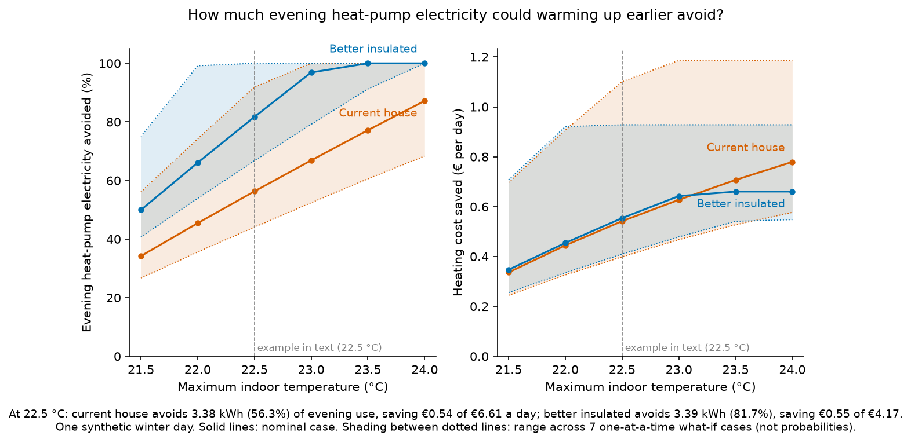

# preheat: how much evening heating could a home do earlier?

A personal curiosity project. I wondered how much of a heat pump's expensive evening electricity a home could avoid by warming up earlier, and whether better insulation changes that, so I built a small tool to explore it. Everything here is synthetic: one invented house on one invented winter day.

## The question

Electricity costs more from 17:00 to 22:00 (€0.38 per kWh instead of €0.22). If the house is warmed a little before 17:00, the heat pump can run less in those hours. You choose one thing: the highest indoor temperature you would accept, from 21.5 to 24 °C. For each choice the tool compares a simple rule that ignores prices with the cheapest schedule a linear programme can find, for the house as it is and for the same house with better insulation.

## The figure



Left: the share of evening heat-pump electricity avoided. Right: euros saved over the whole day. The shaded bands show the range across seven what-if cases (colder or milder day, lighter or heavier house, fewer or more internal gains). They are a range, not probabilities.

## What I found

- At 22.5 °C on the nominal day, the current house avoids 3.38 kWh (56.3%) of its 6.00 kWh evening use and saves €0.54 on a day that otherwise costs €6.61 to heat.
- At 22.5 °C the better-insulated house avoids 3.39 kWh (81.7%) of its 4.15 kWh evening use and saves €0.55 on a day that otherwise costs €4.17 to heat.
- At 22.5 °C both measures put the better-insulated house slightly ahead, but very unevenly: 81.7% against 56.3% of evening use, yet only €0.55 against €0.54 saved. The insulated house uses less in the evening to begin with, so the same kWh is a bigger share of it.
- At 23.5 °C the two measures disagree. The better-insulated house avoids all of its evening use, 4.15 kWh (100.0%), and saves €0.66; it cannot avoid more, so its saving stops growing. The current house avoids 4.63 kWh (77.2%) and saves more, €0.71.
- The savings are small: between €0.34 (21.5 °C) and €0.78 (24.0 °C) per synthetic day for the current house, in absolute euros.
- The what-if range is wide. At 22.5 °C the current house avoids 44.1% (2.52 kWh, €0.40 saved) in the lighter-house case and 91.8% (6.80 kWh, €1.10 saved) in the heavier-house case, so how much heat the house can store matters a great deal.

All numbers come from `results.json`, which `python -m preheat` writes.

## What happens in the house


The price-blind rule only starts heating when it has to, so it runs hard inside the expensive hours. The cost-minimising schedule heats hard just before 17:00, up to the top of the allowed range, so the house drifts down through the evening and needs much less heating in the expensive hours (it still tops up at 18:00 to 21:00 to stay at 21 °C).

## How it works

In plain words: the house is treated as one big "heat battery" that leaks heat to the outside. The heat pump fills it; how much heat it delivers per unit of electricity (the COP, about 3 here) is lower when it is colder outside. The tool then finds the cheapest hour-by-hour heating plan that keeps the house inside the allowed temperatures.

The house is one lump with heat capacity C and a heat-loss coefficient UA, updated hourly with the exact solution `T[t+1] = a·T[t] + (1−a)·(Tout[t] + (COP[t]·p[t] + gains[t])/UA)`, where `a = exp(−UA/C)`. C (kWh/K) is how much energy it takes to warm the house by one degree; UA (kW/K) is how fast heat leaks out per degree of difference to outside. A linear programme (a standard method for finding the cheapest plan under straight-line rules) picks the cheapest hourly heat-pump power that keeps the temperature inside the band. The baseline heats each hour just enough to reach the next hour's minimum. Every schedule is re-checked by an independent simulation, and if a bound is broken no comparison is shown.

## Assumptions (all synthetic)

| Item | Value |
|---|---|
| Heat capacity C | 4 kWh/K |
| Heat-loss coefficient UA | 0.20 kW/K (current), 0.13 kW/K (better insulated); nothing else differs |
| Heat pump | 0 to 4 kW electrical, COP = clip(3 + 0.05·(Tout − 5), 2, 4) |
| Outdoor temperature | 2 °C, but 6 °C from 09:00 to 17:00 |
| Internal gains | 0.2 kW, but 0.5 kW from 17:00 to 22:00 |
| Price | €0.22/kWh, but €0.38/kWh in the hours starting 17:00 to 21:00 |
| Comfort | start 20 °C; at least 20 °C all day and at 24:00; at least 21 °C at 18:00 to 21:00; at most the chosen maximum |

## What this does not show

- One zone with air and structure lumped together; a continuous heat pump with no cycling, defrost or emitter lag.
- Comfort is only air temperature at four checkpoints. No people were involved and nothing is connected to a real heat pump.
- C and UA are assumed, and C drives the result. COP depends only on outdoor temperature, so a lower flow temperature after insulation is ignored.
- The optimiser knows the whole day in advance. It is compared with a stated simple rule, not a real thermostat.
- The seven cases change one assumption at a time. One day only, not extended to any longer period. No real tariffs, weather or renovation costs.

## Optional language layer

A thin layer turns a sentence such as "I'm fine with it getting up to 22 and a half" into one proposed setting, asks you to confirm it, and only then runs the same calculation. The program, not the model, writes every number; the model never ranks or recommends. `python -m preheat ask --offline` replays a recorded session of four conversations without any network. The recorded trace is hand-written (no live model produced it), and no live check against a model has been run. Live mode is optional and needs `PREHEAT_LLM_API_KEY` and `PREHEAT_LLM_MODEL` (see `docs/language-layer.md`).

## How to run

```
python3 -m venv .venv && source .venv/bin/activate
pip install -r requirements.txt
python -m preheat
python -m preheat ask --offline
pytest -q
```

## Sources

- Sperber, Frey & Bertsch (2020), reduced-order models for demand response with heat pumps (model form).
- Yu et al. (2024), effective heat capacity estimate (order of magnitude of C only).
- Lämmle et al. (2021), heat pumps in existing buildings (flow-temperature and COP caveat).
- SciPy documentation for `linprog` / HiGHS.

## Documentation

See [docs/index.md](docs/index.md).
