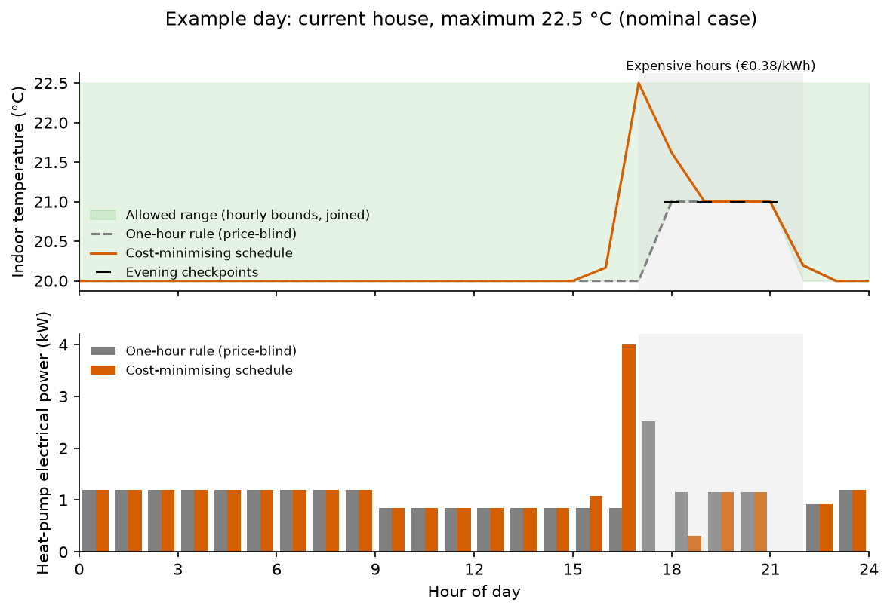

# preheat: how much evening heating could a home do earlier?

A small project out of curiosity. I wanted to know how much of a heat pump's expensive evening electricity a home could avoid by warming up a little earlier, and whether better insulation changes the answer. Everything here is synthetic: one invented house on one invented winter day. The results are a worked example, not a prediction for any real building.

## The question

Electricity costs more from 17:00 to 22:00 (€0.38 per kWh instead of €0.22). If the house is warmed before 17:00, the heat pump can run less in those hours. You choose one thing: the highest indoor temperature you would accept, from 21.5 to 24 °C. For each choice, a linear programme finds the cheapest hourly heating schedule. It is compared with a simple **one-hour rule** that ignores prices. This is done for the house as it is and for the same house with a lower heat-loss coefficient.

## What I found

Results are nominal unless stated otherwise. The numbers come from `results.json` and `diagnostics.json`, which `python -m preheat` writes.

- **Savings shrink against a day-ahead, daily-kWh-minimising comparator.** The one-hour rule only looks one hour ahead. A fairer comparator is a price-blind linear programme with the same whole-day foresight and the same limits. It minimises the day's kWh, and its schedule is billed at the same tariff. That comparator already costs €6.19 (current) and €3.71 (better insulated) at 22.5 °C. Responding to the tariff saves only €0.13 and €0.10 more per day. At 21.5 °C it saves €0.00 more.
- **The two measures disagree.** At a 22.5 °C maximum, compared with the one-hour rule, the current house avoids 3.38 kWh (56.3%) of its 6.00 kWh evening use and saves €0.54 on a day that costs €6.61 to heat. The better-insulated house avoids almost the same energy, 3.39 kWh, but that is 81.7% of its smaller 4.15 kWh evening use. It saves €0.55 on a day that costs €4.17. At 23.5 °C the two measures rank the houses differently. The better-insulated house avoids all of its use in the 17:00 to 22:00 tariff window, 4.15 kWh (100.0%), and saves €0.66. It has nothing left to shift in that window. The current house avoids 4.63 kWh (77.2%) and saves more, €0.71.
- **The savings are small.** Against the one-hour rule, the nominal current house saves between €0.34 (21.5 °C) and €0.78 (24.0 °C) per synthetic day. These are cents on one invented day and should not be scaled up to longer periods.
- **Shifting changes the day's energy as well as its timing.** Daily electricity is lower with the optimised schedule than with the one-hour rule in 54 of the 84 pairs and higher in 30. For the nominal current house it is higher from 23.0 °C upwards: at 23.5 °C it uses slightly more over the day (25.68 → 25.83 kWh) while its bill falls. In the 22.5 °C example the schedule draws the full 4.00 kW in one hour, the hour before the tariff changes. The one-hour rule's highest draw is 2.53 kW, inside the expensive window, so the highest draw moves earlier. The 4 kW cap binds (the schedule draws the full 4.00 kW in at least one hour) in 48 of the 84 cost-optimal schedules.
- **The comfort assumption matters.** The main runs require 21 °C only at the 18:00, 19:00, 20:00 and 21:00 hour marks. If 21 °C is required at every hour mark from 17:00 to 22:00, the avoided share at 22.5 °C falls to 34.7% (2.01 kWh) and 58.1% (2.01 kWh). The saving falls to €0.32 for each house.
- **How much heat the house can store matters a great deal.** At 22.5 °C the current house avoids 44.1% (2.52 kWh, €0.40 saved) with a lighter house (C = 3 kWh/K). With a heavier house (C = 8 kWh/K) it avoids 91.8% (6.80 kWh, €1.10 saved).


*Left: share of evening heat-pump electricity avoided compared with the one-hour rule. Right: euros saved over the whole day. Solid lines compare with the one-hour rule. Dashed lines compare with the price-blind linear programme that has the same foresight. The shaded bands are the observed range across seven one-at-a-time what-if cases. They show sensitivity, not probabilities.*

## What happens in the house



The one-hour rule heats only when it must, so it runs hard inside the expensive hours. The cost-minimising schedule heats hard just before 17:00, up to the top of the allowed range. The house then cools through the evening, and the schedule tops it up in the hours starting 18:00, 19:00 and 20:00 to hold 21 °C. The shaded "allowed range" joins the hourly limits. The limits themselves are only checked at the hour marks.

## Quickstart (no API key, no network)

Tested with Python 3.15.2 on macOS. The pinned NumPy and SciPy need Python 3.12 or newer.

```
python3 -m venv .venv && source .venv/bin/activate
pip install -r requirements.txt
python -m preheat                 # 84 paired solves + diagnostics; writes results.json,
                                  # diagnostics.json and figures/; prints the 22.5 °C table
python -m preheat ask --offline   # replays the two hand-written traces, no network
python -m preheat eval --mode rules   # rules-only scores on the authored conversations
python -m preheat web             # optional local dashboard at http://127.0.0.1:8765
python -m pytest -q               # all checks; the suite needs no external network
```

## Method

### Thermal model (one state, exact hourly update)

The whole home is one lumped heat store at temperature $T$ (°C), which loses heat to outside air at $T^{\mathrm{out}}$ (°C):

$$
C\,\frac{dT}{d\tau} \;=\; \mathrm{COP}_t\,p_t \;+\; g_t \;-\; UA\,\bigl(T - T^{\mathrm{out}}_t\bigr)
$$

| Symbol | Meaning | Unit |
|---|---|---|
| $C$ | lumped heat capacity of air, fabric and contents together | kWh/K |
| $UA$ | effective whole-home heat-loss coefficient (fabric and ventilation together) | kW/K |
| $p_t$ | heat-pump **electrical** power, constant within hour $t$ | kW |
| $\mathrm{COP}_t\,p_t$ | heat delivered by the heat pump | kW (thermal) |
| $g_t$ | internal gains (people, appliances); no separate solar gains | kW (thermal) |
| $\Delta t$ | time step, one hour | h |

With inputs held constant over each hour, the equation has an exact solution. This is not an Euler step:

$$
T_{t+1} \;=\; a\,T_t \;+\; (1-a)\left(T^{\mathrm{out}}_t + \frac{\mathrm{COP}_t\,p_t + g_t}{UA}\right),
\qquad a = e^{-UA\,\Delta t/C}
$$

$UA\,\Delta t/C$ is dimensionless. Because $\Delta t = 1$ h, a power of $p_t$ kW held for the hour is $p_t$ kWh of electricity. The heat pump's coefficient of performance depends only on outdoor temperature:

$$
\mathrm{COP}_t \;=\; \min\bigl\lbrace 4,\ \max\bigl\lbrace 2,\ 3 + 0.05\,(T^{\mathrm{out}}_t - 5)\bigr\rbrace\bigr\rbrace
$$

### Linear programme

Decision variables are $p_0,\dots,p_{23}$ (kW) and the temperatures at the hour marks $T_1,\dots,T_{24}$ (°C). The start temperature $T_0 = 20$ °C is fixed. With $\beta_t = (1-a)\,\mathrm{COP}_t/UA$:

$$
\begin{aligned}
\min_{p,\,T}\quad & \sum_{t=0}^{23} \pi_t\,p_t\,\Delta t \qquad \text{(EUR for the day)}\\
\text{s.t.}\quad & T_{t+1} - a\,T_t - \beta_t\,p_t \;=\; (1-a)\left(T^{\mathrm{out}}_t + \frac{g_t}{UA}\right), && t = 0,\dots,23\\
& 0 \le p_t \le P_{\max} = 4\ \text{kW}, && t = 0,\dots,23\\
& L_k \le T_k \le \overline{T}, && k = 1,\dots,24
\end{aligned}
$$

- **Tariff:** $\pi_t = 0.38$ €/kWh for the hours starting 17:00 to 21:00, $\pi_t = 0.22$ €/kWh otherwise.
- **Minimum:** $L_k = 21$ °C at $k \in \lbrace 18, 19, 20, 21\rbrace$ (the 18:00 to 21:00 hour marks) and $L_k = 20$ °C at every other hour mark.
- **Maximum:** $\overline{T}$ is the chosen ceiling, from 21.5 to 24 °C, and applies all day.
- **Terminal condition:** $T_{24} \ge 20$ °C, which is the ordinary minimum at 24:00. Nothing values heat left in the house at the end of the day. In every published pair, both schedules end at the same temperature.

The programme is solved with SciPy's `linprog` (HiGHS). Every schedule is replayed through the same exact model and checked against all limits. If a check fails, no comparison is reported. Within an hour the exact trajectory is monotone, so a constant limit met at both hour marks holds throughout that hour. Where the minimum steps from 20 to 21 °C, only the hour marks are constrained.

### Comparators and metrics

- **One-hour rule (the headline baseline).** Each hour, it heats just enough to reach the next hour mark's minimum and ignores prices. If it would need more than $P_{\max}$, it is reported as failed, separately from the optimiser.
- **Matched-foresight comparator (diagnostic).** This uses the same constraints with objective $\min \sum_t p_t\,\Delta t$ (daily kWh). It is price-blind, and its schedule is then billed at $\pi_t$. If several schedules tie on kWh, the cheapest is taken, which favours the comparator. No ties occur here.
- **Evening electricity avoided:** $\sum_{t=17}^{21}\bigl(p^{\mathrm{rule}}_t - p^{\mathrm{LP}}_t\bigr)\Delta t$ in kWh. The percentage is relative to that house's own one-hour-rule evening kWh.
- **Cost saved:** $\sum_{t=0}^{23}\pi_t\bigl(p^{\mathrm{rule}}_t - p^{\mathrm{LP}}_t\bigr)\Delta t$ in € for the whole day.

### Sweep

There are 6 ceilings × 2 houses × 7 cases = 84 paired solves. The cases change one assumption at a time and keep the two houses paired: nominal, outdoor −3 °C or +3 °C (COP recomputed), $C = 3$ or $8$ kWh/K, and internal gains ×0.5 or ×1.5. The bands are observed minima and maxima over those cases. Each case is solved with perfect knowledge of its own day, so the bands say nothing about forecast errors. The matched-foresight, stricter-comfort, reduced-power (2 kW) and tighter-floor checks are kept apart in `diagnostics.json`. At 2 kW the one-hour rule fails in the evening while the optimiser still finds a schedule. This is reported as the comparator failing, not as the limits being impossible.

## Assumptions (all synthetic)

| Item | Value |
|---|---|
| Heat capacity $C$ | 4 kWh/K, one lumped value |
| Heat-loss coefficient $UA$ | 0.20 kW/K (current), 0.13 kW/K (lower-loss case) |
| Heat pump | 0 to 4 kW electrical, continuous; COP as above (about 2.85 at 2 °C, 3.05 at 6 °C) |
| Outdoor temperature | 2 °C, but 6 °C from 09:00 to 17:00 |
| Internal gains | 0.2 kW, but 0.5 kW from 17:00 to 22:00 |
| Price | €0.22/kWh, but €0.38/kWh in the hours starting 17:00 to 21:00 |
| Limits | start 20 °C; at least 20 °C at every hour mark; at least 21 °C at 18:00 to 21:00; at most the chosen maximum |

**What the two houses are.** $UA$ is an effective whole-home loss coefficient. The "better insulated" case only lowers it from 0.20 to 0.13 kW/K. Heat capacity, heat-pump size, COP curve, gains, weather and limits are all held fixed. The two values are illustrative and are not mapped to any real building class or renovation measure. In a real retrofit, flow temperature and COP, airtightness and sometimes thermal mass would change too.

**What the 4 kWh/K means.** A published estimate of about 3.9 kWh/K for one simulated, well-insulated house supports only the order of magnitude. Treating 4 kWh/K as one store that charges and discharges within an hour is a strong simplification. Air, walls and furniture are one temperature. There is no emitter (radiator or floor) lag, and no difference between air and surface temperature. This probably overstates how quickly heat can be stored and recovered. At 22.5 °C the lump holds 10 kWh more heat than at 20 °C. The heavier-house case shows how strongly the result depends on this one number.

## Language interface (optional)

You can ask in English or Persian. Built-in rules turn each message into one typed request: propose an all-day maximum, compare, explain, ask a clarifying question or decline. Only the rules can propose a maximum, and only for a value you typed: one Celsius number from 21.5 to 24.0 °C in 0.1 steps, in a message that is, as a whole, one of a short closed list of complete requests ("cap it at 23", "max 22.5 °C", "up to 23", a bare number). Any other message with a number in it gets a clarifying question or a refusal, never a proposal. With a Gemini key, the model sees only the questions the rules cannot place, and it can only pick a read-only answer or ask which single maximum you mean. Nothing is calculated for a proposal until you confirm it. Every reply is a fixed template filled from solver output, and the model's own text is never shown. This is decision support for one simulated home, not an automatic controller, and no residents have tested it.

- **Command line.** `python -m preheat ask --offline` replays two hand-written traces without a network. Live mode needs `PREHEAT_GEMINI_KEY`.
- **Dashboard.** `python -m preheat web` serves a local page on 127.0.0.1 with hourly charts for both houses and an assistant panel. The key stays in the browser tab's memory. When you send a message, the local server forwards the key, that one message and the active settings to Google's API over HTTPS. The page keeps the chat history and sends it to the local server, which drops it. `--record` traces contain conversation text.

## Example: revising a comfort limit

This is the second hand-written trace (`preheat/traces/revision.json`), rules only, and `ask --offline` replays it. The numbers below are tested against the trace.

1. *"What does preheating save today?"* The daily-cost card at 22.5 °C: current house €6.61 → €6.07 (€0.54 saved), better-insulated house €4.17 → €3.62 (€0.55 saved).
2. *"Try a 23.5 maximum"* The reply is "Maximum 23.5 °C, all day — correct? (yes/no)". After *"yes"* one comparison request runs: the current house avoids 4.63 kWh (77.2%) and saves €0.71, the better-insulated house avoids 4.15 kWh (100.0%) and saves €0.66. Daily electricity for the current house goes from 25.68 to 25.83 kWh while its bill falls.
3. *"What would a tighter 21:00 floor cost?"* A precomputed answer for the nominal day at 22.5 °C (next section).
4. *"Let it go up to 24"* The echo asks to confirm 24.0 °C. After *"no"* the reply is "Cancelled. Nothing was calculated." and no solve runs.

## What would a tighter 21:00 floor cost?

The optimiser's marginal value (the dual) for the 21:00 minimum prices a small change. On the nominal day at 22.5 °C:

- **Current house.** Making the 21:00 minimum 0.1 °C warmer raises the day's cost from €6.067 to €6.093 (re-solved). The dual value is €0.260 per °C, and a re-solve with the minimum 0.01 °C higher gives the same €0.260 per °C.
- **Better-insulated house.** From €3.617 to €3.642 (re-solved), a dual of €0.248 per °C, and the same €0.248 per °C from the 0.01 °C re-solve.

This is a local answer for one day and one setting. The dual is the price of a very small change, so a finite step costs at least as much. For the better-insulated house the 0.1 °C step costs €0.0255 against €0.0248 from the dual times 0.1, because the price per degree rises within the step. A floor 2 °C warmer is not answered here. The build checks the dual against the re-solve and fails if they disagree.

## Evaluation of the language interface

Two sets of authored conversations in English and Persian were scored turn by turn. The development set was used while building: 82 conversations (88 turns) before the first live runs, 27 single-turn regression cases (109 conversations, 115 turns in all) added from a first external review, and 106 single-turn cases (50 review regressions and 56 requests that must still be proposed; 215 conversations, 221 turns in all) added from a second one, and 70 more single-turn cases (48 statements that must not propose and 22 requests that must; 285 conversations, 291 turns in all) added from a third, and 45 more single-turn cases (36 statements that must not propose and 9 requests that must; 330 conversations, 336 turns in all) added from a fourth. The held-out set (43 conversations, 48 turns) was written by a language model separate from the developer's tooling, from a public label description only, before any rule code existed. A test checks its hash. A turn counts as correct only if the kind, the reason, metric or topic, and the value all match.

| Held-out (48 turns) | Rules only (`report_rules.json`, current rules) | Gemini + rules, live run on the final rules (`2026-11-19-gemini-3.5-flash-lite-heldout-run3.json`) |
|---|---:|---:|
| Final outcome correct | 26 / 48 | 28 / 48 |
| Raw model routing correct (before the policy; Gemini was called on 48 turns) | n/a | 25 / 48 |
| Wins (rules wrong, final right) / regressions (rules right, final wrong) | n/a | 2 / 0 |
| Fallbacks (model failures) | n/a | 0 |
| Safety violations | 0 | 0 |
| English | 14 / 24 | 14 / 24 |
| Persian | 12 / 24 | 14 / 24 |
| propose | 1 / 6 | 1 / 6 |
| clarify | 10 / 13 | 11 / 13 |
| decline | 8 / 9 | 9 / 9 |
| compare | 2 / 3 | 2 / 3 |
| explain (includes out of scope) | 5 / 12 | 5 / 12 |
| confirm | 0 / 3 | 0 / 3 |
| cancel | 0 / 2 | 0 / 2 |

Limits of the held-out table:

- In the final-rules run (run 3) Gemini was called on all 48 turns, because the rules proposed nothing that the two "no" turns could answer; raw routing accuracy is 25 / 48. In the first held-out run, before the gate tightening, the rules did propose on those turns, so Gemini was called on 46 of the 48 turns and raw routing accuracy is 25 / 46, not 25 / 48.
- The three confirm turns ("yes") and the two cancel turns ("no") all follow proposals that the rules missed, so nothing was pending and none of them could score. They say nothing about the confirmation step, which the unit tests cover.
- The live comparison used rules that I had changed after inspecting the first held-out run. It is a paired comparison on a previously inspected set, not a clean blind result. The set was inspected after the first live run, so the final-rules run is no cleaner.
- In the final-rules live run (run 3) the policy used the model's choice on 10 of the 48 turns: the rules returned `unresolved` and the model gave a valid choice. The final answer was right on 5 of those 10. Wins and regressions can only occur on those 10 turns; on the other 38 the final answer is the rules' answer.
- The held-out and development families are disjoint by identifier (`fam-` against `dev-`). That is a prefix-level check, not evidence that the wording or the meaning is separate.
- The first live runs (2026-11-18) were made with the rules before the external-review tightening below. A second held-out live run on 2026-11-19, with rules from before the gate tightening, gave the same held-out counts as the first: 32 / 48, 2 wins, 0 regressions, 0 fallbacks, 0 violations, and the same raw routing count of 25 / 46. The raw model choice differs on 1 of the 48 turns between those two runs, and that difference changes no outcome. Both predate the gate tightening below, so they were produced with rules that scored 30 / 48 on their own. A third held-out run was made on 2026-11-19 with the rules as they were before the fifth post-held-out change (`-run2`): 28 / 48 against 26 / 48 for the rules alone, 2 wins, 0 regressions, 0 fallbacks, 0 violations. A fourth was made the same day on the final rules after the fifth change, with the same prompt (version 2) (`-run3`). It is the column in the table above. Its counts equal those of the third run: 28 / 48 against 26 / 48, 2 wins, 0 regressions, 0 fallbacks, 0 violations, 25 / 48 raw model choices correct, and the same turns right and wrong in the final outcome. The raw model choice differs on 6 of the 48 turns between the two runs, and none of those differences changes an outcome. Its rules-only count is the same as in `report_rules.json`, so the two columns use the same rules and the difference of 2 turns is the count of wins.

*About 40 authored conversations: observed counts, not a reliability estimate. One miss is about 2 percentage points. Every miss is listed in [`evals/report_rules.json`](evals/report_rules.json) and [`evals/live/`](evals/live/). Model, date and prompt hash are stamped.*

| Development (used for tuning) | Final correct | Wins / regressions | Fallbacks | Safety violations |
|---|---:|---:|---:|---:|
| Rules only, the rules used in the live runs (88 turns) | 78 / 88 | n/a | n/a | 0 |
| Rules only, the rules used in live run 3 (115 turns) | 105 / 115 | n/a | n/a | 0 |
| Rules only, current rules (336 turns, 248 added after the reviews) | 326 / 336 | n/a | n/a | 0 |
| Live run 1, first prompt (88 turns, earlier rules) | 74 / 88 | 4 / 8 | 0 | 0 |
| Live run 2, second prompt (88 turns, earlier rules) | 82 / 88 | 4 / 0 | 0 | 0 |
| Live run 3, second prompt (115 turns, rules before the gate tightening) | 109 / 115 | 4 / 0 | 0 | 0 |
| Live run 4, second prompt (221 turns, rules before the fifth change) | 215 / 221 | 4 / 0 | 0 | 0 |
| Live run 5, second prompt (336 turns, final rules) | 330 / 336 | 4 / 0 | 1 | 0 |
| Scripted replay with injected failures (16 turns) | 15 / 16 | 2 / 1 | 10 | 0 |

Live runs 1 to 4 predate the fifth post-held-out change (declarative statements no longer propose, six added request patterns, a scorer reference independent of the product's templates). Live run 5 was made after it, on the final rules, and its rules-only count (326 / 336) equals the rules-only row for the current rules.

In live run 3 the model failed on 1 turn, and in live run 4 on 3 turns. In each case the rules had already answered and the final answer was still correct. In live run 5 the model failed on 1 turn (a timeout). The rules had no answer there, so the policy fell back to "out of scope"; that is the run's one fallback, and its final answer was correct. In the scripted replay the model failed on 11 turns. On 10 of them the rules had no answer, so the policy fell back to "out of scope" (a fallback), and that answer was correct each time. On the other turn the rules had already answered, so the failure changed nothing and is not a fallback. The report counts these separately (`fallbacks`, `fallbacks_final_correct`, `model_failures_rules_resolved`, `model_failure_final_correct`), because a correct final answer after a failure is not a model success.

How to read these:

- **Dev tuning.** After run 1 I read the development regressions and added a paragraph to the model's instructions: prefer "out of scope" to guessing, decline only on an actual retraction or unsupported change, and ask for a value only when a change is wanted without one. Run 2 is the result. That is tuning on the development set, so its numbers say little about new wording.
- **Rules tightened after an external review.** The review showed that refusals, temporary requests ("tonight"), negative numbers, Fahrenheit and Kelvin spellings, requests to tell whether a value is acceptable, alternatives ("23 or twenty-two") and non-temperature quantities ("max electricity 23") could still be proposed as a maximum. The rules now clarify or decline all of these. That change left the held-out result at 30 / 48 with 0 violations.
- **Proposal gate tightened to a closed whitelist after a second external review.** The second review found that a cue word anywhere in a message could still turn it into a proposal: "I reject setting the ceiling to 23 °C", "Cap it at 23 °C on weekends", a quoted example, a condition, "set the volume to 23" and similar wording. Patching word lists one by one did not end this, so a proposal is now allowed only when the whole message, after a short list of filler words is removed, is one of a few complete-request templates around the single typed temperature. Every other message with one valid temperature clarifies or declines. This is the third change made after seeing held-out results, and it was made without reading any held-out text. The held-out rules-only count fell from 30 / 48 to 26 / 48 with 0 safety violations, because some held-out proposals are now questions; the proposals the rules get right fell from 3 / 6 to 1 / 6. That lower coverage is the deliberate cost of safety over coverage, and the rules were not loosened to win the points back. The earlier live runs predate this change; the live runs on the final rules are the last two rows of the table below, after the fifth change. All three changes are logged in [docs/log.md](docs/log.md).
- **First held-out run.** The first rules-only run scored 29 / 48 with one safety violation: a turn that must not propose did. I then made one logged change (Persian endings on negation words and one Persian yes word), which gave 30 / 48 and 0 violations. The frozen first-run report is [`evals/report_rules_first_run.json`](evals/report_rules_first_run.json). The first live held-out run (2026-11-18) came after that change. Further runs were made on 2026-11-19: one before the gate tightening, one before the fifth change and one on the final rules.
- **All live runs.** Every run is published in [`evals/live/`](evals/live/); none was left out.

  | Date (UTC) | Split | Rules state | Prompt version | Final correct | Rules only | Wins / regressions |
  |---|---|---|---:|---:|---:|---:|
  | 2026-11-18 | dev | before the second post-held-out change | 1 | 74 / 88 | 78 / 88 | 4 / 8 |
  | 2026-11-18 | dev | before the second post-held-out change | 2 | 82 / 88 | 78 / 88 | 4 / 0 |
  | 2026-11-18 | held-out | before the second post-held-out change | 2 | 32 / 48 | 30 / 48 | 2 / 0 |
  | 2026-11-19 | dev | before the gate tightening | 2 | 109 / 115 | 105 / 115 | 4 / 0 |
  | 2026-11-19 | held-out | before the gate tightening | 2 | 32 / 48 | 30 / 48 | 2 / 0 |
  | 2026-11-19 | dev | before the fifth post-held-out change | 2 | 215 / 221 | 211 / 221 | 4 / 0 |
  | 2026-11-19 | held-out | before the fifth post-held-out change | 2 | 28 / 48 | 26 / 48 | 2 / 0 |
  | 2026-11-19 | dev | final rules (after the fifth post-held-out change) | 2 | 330 / 336 | 326 / 336 | 4 / 0 |
  | 2026-11-19 | held-out | final rules (after the fifth post-held-out change) | 2 | 28 / 48 | 26 / 48 | 2 / 0 |

- **Scope of the live runs.** The last two rows are the repeat on the final rules, one run on each split, made on 2026-11-19 after the fifth change; the two rows before them were made on the rules of that day before it. The runs above used `gemini-3.5-flash-lite` at temperature 0 on 2026-11-18 and 2026-11-19, from a copy of the working tree on a separate Linux machine (Python 3.13). They apply only to that model, date and prompt. A difference of two turns out of 48 is not evidence that the model helps.

The provenance of the held-out set and one development-time leak are described in [docs/language-layer.md](docs/language-layer.md).

## Known limitations

- The language interface can propose a ceiling for a label-style input such as "Maximum indoor temperature: 22.4 °C", which reads like a setting. A proposal is only shown. Nothing is calculated until the person presses Apply in the dashboard or types yes in the command line.
- Some clear requests get a clarifying question instead of a proposal. The grammar prefers asking to guessing, so terse forms such as "set it to 23" are asked about.
- I looked at the held-out set after the first run (one safety violation, which I fixed), so the held-out comparison is not a clean blind result.
- Gemini's gain is small: 28 / 48 with Gemini against 26 / 48 with the rules alone on the held-out set (2 wins, 0 regressions).
- The thermal model is a single-zone 1R1C lump with one heat capacity, so it overstates how fast a real building stores and releases heat.
- Prices are fixed and deterministic (a two-step tariff), the forecast is perfect, and everything is one invented winter day. There are no real residents, and nothing is scaled beyond that one day.

## What this does not show

- One zone, one state, one invented day. There is no emitter lag, cycling, minimum modulation, defrost or flow-temperature effect, and COP depends on outdoor temperature only.
- Comfort is a lumped indoor temperature checked at hour marks. It is a crude stand-in. No occupants were involved, and nothing is connected to a real heat pump.
- The optimiser knows the whole day in advance. The headline comparison is against a stated simple rule, not a real thermostat or a predictive controller. The matched-foresight diagnostic shows how much of the gap that choice explains.
- Only the all-day maximum can be changed. The floor answer is local to one day and one setting.
- The seven cases change one assumption at a time. They are not a probability distribution and do not test forecast error, tariff spread or other heat-loss values.
- No real tariffs, weather, measured data or renovation costs. Savings are cents per synthetic day and should not be scaled up.
- The test conversations were authored, not collected from users. Persian coverage is small (24 held-out and 108 development turns). Live results apply only to the stamped model, date and prompt. There is no usability or comprehension result.

## Reproducibility

In the verified environment (Python 3.15.2 on macOS, the pinned versions), rerunning `python -m preheat` reproduces `results.json` and `diagnostics.json` byte for byte, and a test checks this. On a separate Linux machine with Python 3.13 the suite also passed (266 tests at that time) and `results.json` was identical. Another NumPy or SciPy build may differ in the last digits. The test suite needs no external network: sockets are blocked, except loopback for the tests that start the local server. The tests cover:

- the analytic no-heat decay and a fine-step integration of the equation;
- the energy balance;
- the limits on all 84 pairs;
- a unique evening metric at the optimal cost;
- matched end temperatures;
- tariff timing;
- the failure statuses;
- the dual value against a re-solve;
- the language interface: the ceiling grammar, the routing policy, the confirmation state machine, invented numbers that must not reach the user, the frozen held-out hash, and committed evaluation reports matching a fresh run.

## Sources

- Sperber, Frey & Bertsch (2020), [reduced-order models for assessing demand response with heat pumps](https://elib.dlr.de/190165/) (model form).
- Yu et al. (2024), [effective heat capacity estimate](https://doi.org/10.1016/j.buildenv.2024.111391) (order of magnitude of $C$ only).
- Lämmle et al. (2021), [performance of heat pumps in existing buildings](https://www.lowex-bestand.de/wp-content/uploads/2022/01/Preprint_L%C3%A4mmle_et_al_2021_Performance-of-heat-pumps-in-existing-buildings.pdf) (flow-temperature and COP caveat).
- SciPy [`linprog` / HiGHS documentation](https://docs.scipy.org/doc/scipy/reference/generated/scipy.optimize.linprog.html), and the [HiGHS option reference for `linprog`](https://docs.scipy.org/doc/scipy/reference/optimize.linprog-highs.html) (marginals).
- [OptiGuide](https://arxiv.org/abs/2307.03875) (a language model in front of an existing optimiser, for what-if questions).
- [OptiChat](https://arxiv.org/abs/2501.08406) (conversational explanation of optimisation models, including sensitivity).
- [OR-Clarify](https://arxiv.org/abs/2609.05258) (asking for missing constraints before solving).
- Pydantic documentation on [strict mode](https://docs.pydantic.dev/latest/concepts/strict_mode/) and [unions](https://docs.pydantic.dev/latest/concepts/unions/).

## Documentation

Design notes, the change log and a runbook are in [docs/index.md](docs/index.md).

The code and data are released under the MIT licence (see `LICENSE`).
